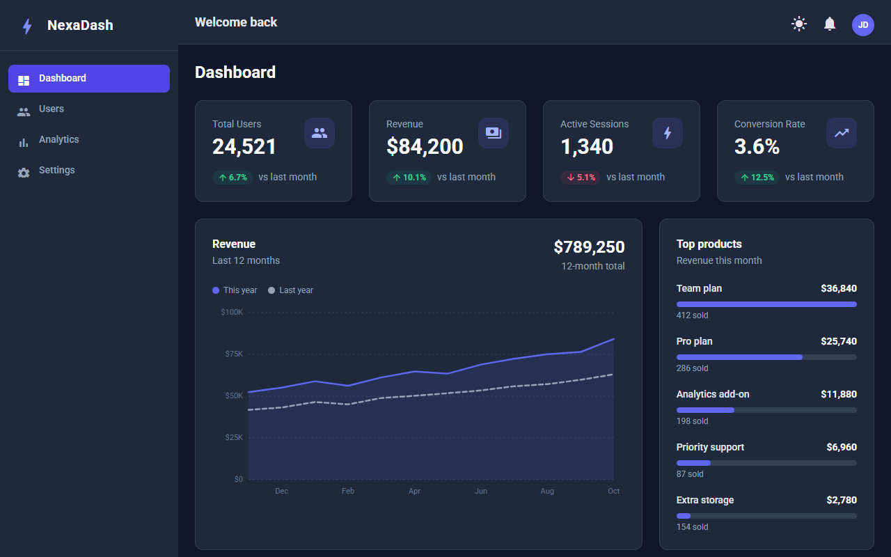
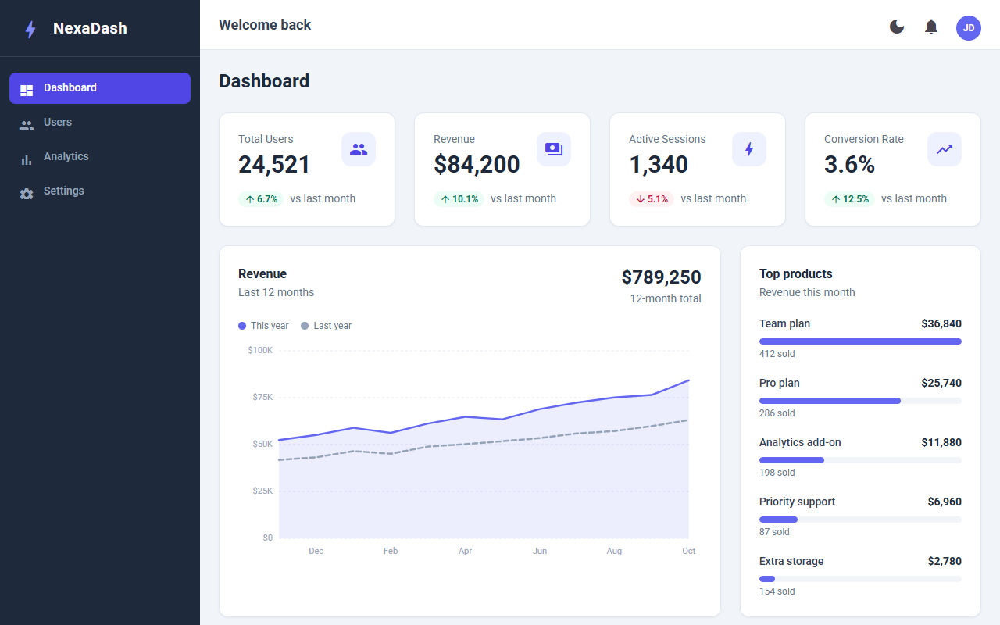
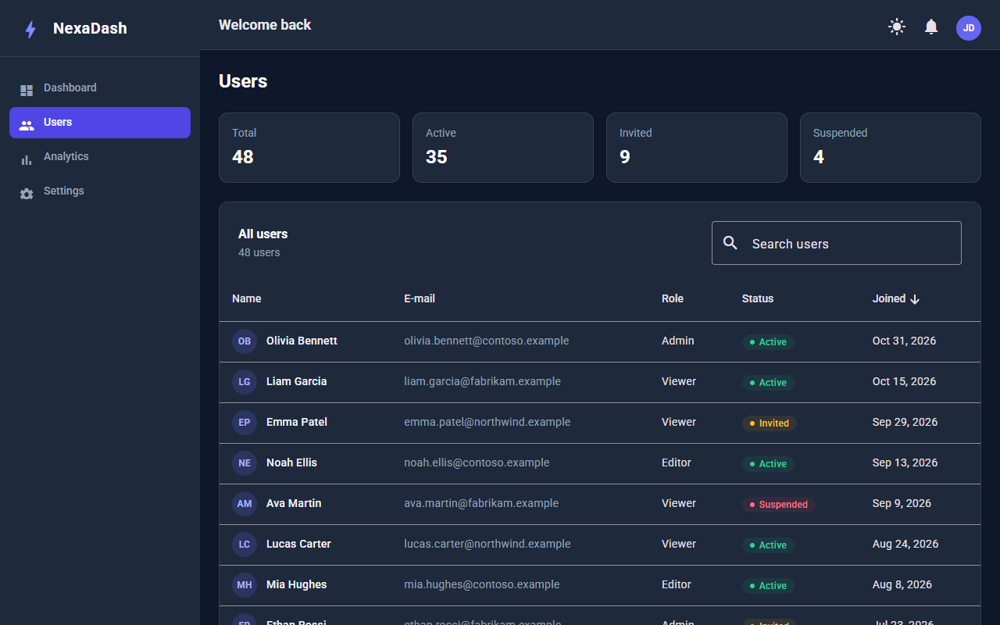
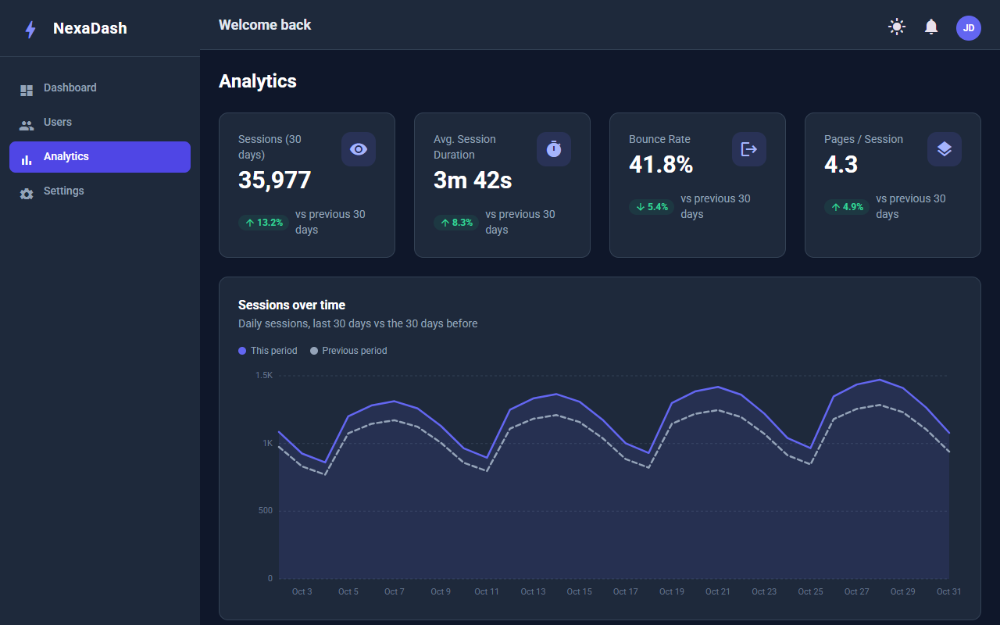
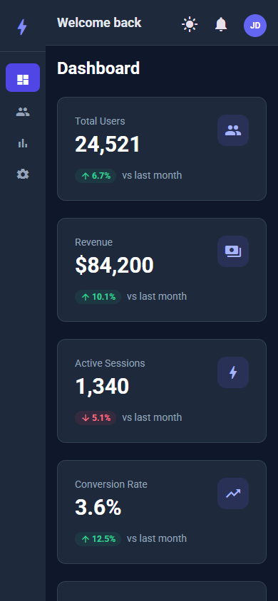

# NexaDash

Admin dashboard starter built with Angular 21 standalone components, Angular Material and Tailwind CSS. It ships with dashboard, users, analytics and settings pages driven by a typed mock data layer, so it runs without any backend.


[](https://github.com/Ahmed-Manai/nexadash/actions/workflows/ci.yml)

**[Live demo](https://ahmed-manai.github.io/nexadash/)** · If this starter helps you, a ⭐ helps others find it.



<details>
<summary>More screenshots: light mode, users, analytics, mobile</summary>






</details>

## Features

- **Dashboard**: stat cards with a trend indicator (change vs the previous period, colored by whether the change is good news), a 12-month revenue line chart compared with the previous year, a top products breakdown and a recent orders table with status badges.
- **Users**: Angular Material table over 48 mock users with sorting, pagination, a search filter (name, e-mail, role, status), status badges, summary counts and an empty state.
- **Analytics**: traffic stat cards, a 30-day sessions line chart (current vs previous period), traffic by source as a horizontal bar chart and monthly sign-ups as a vertical bar chart.
- **Settings**: profile form built with reactive forms and validation messages (required, length, e-mail), save / discard handling with a snackbar, and a light / dark theme preference that uses the same `ThemeService` as the top bar toggle.
- **Dependency-free SVG charts**: reusable `app-line-chart` (multi-series, area fill, legend, hover tooltip) and `app-bar-chart` (vertical or horizontal). Each chart measures its own width with a `ResizeObserver` and draws in real pixels, so text stays crisp at any size. No charting library is added to the bundle.
- **Deterministic mock data layer**: typed models and a `MockDataService` exposing read-only signals (plus an Observable `getUsers()`). The data is generated from fixed values and a fixed reference date, never `Math.random()` or the current date, so screenshots and tests are stable. Sample companies use fictional names (Contoso, Fabrikam, Northwind...) and e-mail addresses use the reserved `.example` domain.
- **App shell layout**: sidebar, top bar and a scrollable content area that hosts routed pages. Below the `md` breakpoint the sidebar collapses to an icon rail with tooltips, so pages stay usable down to 375px wide; wide tables scroll horizontally inside their card.
- **Lazy-loaded routes**: the shell and every page are loaded with `loadComponent` and set a page title; unknown URLs redirect to the dashboard.
- **Light / dark theme toggle**: `ThemeService` stores the choice in `localStorage`, falls back to the OS `prefers-color-scheme` setting, and toggles the `dark` class on `<html>`. That class drives both Tailwind's `dark:` variants and the Angular Material palette (through `color-scheme`, since `mat.theme()` emits `light-dark()` colors).
- **Top bar** with theme switch, notifications button and an account menu showing the current profile, with links to Settings.
- **Material 3 theming** via `mat.theme()` (violet primary, blue secondary, orange tertiary) combined with Tailwind utility classes.
- **Unit tests** for the mock data service, theme service, formatters, chart scales, every shared component, every page and the route table (Vitest + jsdom).
- **Code quality tooling**: ESLint (angular-eslint + typescript-eslint), Prettier, and a Husky pre-commit hook running lint-staged.

## Tech stack

| Area                 | Tool                                            | Version           |
| -------------------- | ----------------------------------------------- | ----------------- |
| Framework            | Angular (standalone components, signals-ready)  | ^21.2             |
| UI components        | Angular Material / CDK                          | ^21.2             |
| Styling              | Tailwind CSS, PostCSS, Autoprefixer, SCSS       | ^3.4              |
| Language             | TypeScript                                      | ~5.9              |
| Reactive state       | RxJS                                            | ~7.8              |
| Build                | `@angular/build` (esbuild application builder)  | ^21.2             |
| Unit tests           | Vitest + jsdom (via `@angular/build:unit-test`) | ^4.0              |
| Linting / formatting | ESLint, angular-eslint, Prettier                | ^10 / 21.4 / ^3.8 |
| Git hooks            | Husky + lint-staged                             | ^9 / ^17          |

## Project structure

```text
src/
├── index.html                       # Loads Roboto and Material Icons fonts
├── main.ts                          # bootstrapApplication(App, appConfig)
├── styles.scss                      # Material theme, Tailwind layers, shared .card / .badge / .page-header
└── app/
    ├── app.ts / app.html            # Root component (router outlet)
    ├── app.config.ts                # Router providers
    ├── app.routes.ts                # Shell route with lazy-loaded pages
    ├── core/
    │   ├── models/                  # User, Order, StatMetric, chart point / series types
    │   ├── data/
    │   │   └── mock-data.ts         # Deterministic mock data (fixed reference date, no randomness)
    │   └── services/
    │       ├── mock-data-service.ts # Read-only signals over the mock data, profile updates
    │       └── theme-service.ts     # Light/dark theme state
    ├── shared/
    │   ├── components/
    │   │   ├── line-chart/          # SVG line chart (multi-series, tooltip, legend)
    │   │   ├── bar-chart/           # SVG bar chart (vertical / horizontal)
    │   │   └── stat-card/           # Metric card with trend indicator
    │   └── utils/                   # Number formatters, chart scales, element width signal
    ├── layout/
    │   ├── shell/                   # App shell (sidebar + topbar + <router-outlet>)
    │   ├── sidebar/                 # Navigation (icon rail on small screens)
    │   └── topbar/                  # Theme toggle, notifications, account menu
    └── features/
        ├── dashboard/               # Stat cards, revenue chart, top products, recent orders
        ├── users/                   # Sortable, paginated, searchable users table
        ├── analytics/               # Traffic stats and charts
        └── settings/                # Profile form and theme preference
```

The intended layering (core / shared / features / layout) is described in [Notes](#architecture-notes).

## Getting started

### Prerequisites

- Node.js 22 (or another version supported by Angular 21: `^20.19`, `^22.12` or `>=24`)
- npm 10+ (the project declares `npm@11.9.0` as its package manager)

### Install

```bash
npm install
```

### Run the dev server

```bash
npm start            # ng serve, then open http://localhost:4200/
```

### Build

```bash
npm run build        # production build into dist/nexadash
npm run watch        # development build in watch mode
```

To serve the app from a sub-path (for example a GitHub Pages project site), set the base href at build time:

```bash
npx ng build --base-href /nexadash/
```

### Test and lint

```bash
npm test                     # ng test (Vitest, watch mode)
npm test -- --watch=false    # single run, as in CI
npm run lint                 # ng lint
```

GitHub Actions (`.github/workflows/ci.yml`) runs lint, unit tests and the production build on Node 22 for every push and pull request. See [CONTRIBUTING.md](CONTRIBUTING.md) for the contribution workflow.

## Mock data

All pages read from `MockDataService` (`src/app/core/services/mock-data-service.ts`), which wraps the constants in `src/app/core/data/mock-data.ts`. To connect a real API, keep the service's public signals and replace their sources with `HttpClient` calls (for example with `toSignal()` or `resource()`); components do not need to change. Profile edits on the Settings page are kept in memory only and reset on reload.

## Roadmap / ideas

- Authentication (login page, route guards, HTTP interceptors)
- Replace `MockDataService` with an HTTP-backed implementation
- Date range selection for the analytics charts
- User detail / edit dialog on the Users page

## Notes

### Setup commands used to create the project

```bash
npm install -g git-cz                                  # commitizen CLI for conventional commits
npm install -g @angular/cli                            # Angular CLI
ng new nexadash --routing --style=scss                 # project with routing and SCSS
npx ng build --configuration=development               # verify that it compiles
ng serve                                               # start the app
```

ESLint, Prettier and Git hooks:

```bash
npx ng add @angular-eslint/schematics --skip-confirmation
npm install --save-dev prettier eslint-config-prettier
npm install --save-dev husky lint-staged
npx husky init
npx lint-staged                                        # run the staged-file checks manually
```

Angular Material and Tailwind CSS:

```bash
npx ng add @angular/material --skip-confirmation
npm install -D tailwindcss@3 postcss autoprefixer
npx tailwindcss init
```

App shell scaffolding:

```bash
ng g s core/services/theme-service
ng g c layout/sidebar
ng g c layout/topbar
ng g c layout/shell
ng g c features/dashboard
```

### Commit convention

Commits follow the [Conventional Commits](https://www.conventionalcommits.org/) format (`feat:`, `fix:`, `docs:`, `chore:` ...). `git-cz` can be used to write them interactively. On every commit, Husky runs `lint-staged`, which applies `eslint --fix` and `prettier --write` to staged `*.ts` / `*.html` files and `prettier --write` to staged `*.scss`, `*.css`, `*.json` and `*.md` files.

### NgModule vs standalone components

```text
NgModule bootstrap flow (older approach):
  main.ts
    → platformBrowserDynamic().bootstrapModule(AppModule)
      → AppModule (@NgModule)
        → declarations: [AppComponent]  ← every component must be declared here
        → imports: [BrowserModule, AppRoutingModule]
        → AppRoutingModule (@NgModule)
          → imports: [RouterModule.forRoot(routes)]

Standalone bootstrap flow (used in this project):
  main.ts
    → bootstrapApplication(App, appConfig)
      → App (standalone, imports its own dependencies)
      → appConfig (providers: [provideRouter, ...])
```

### Architecture notes

Target folder layout as the project grows:

```text
src/app/
├── core/         ← singleton services, interceptors, guards (auth, theme, logger)
├── shared/       ← presentational components, directives, pipes, pure utilities
├── features/     ← lazy-loaded feature slices (dashboard, users, analytics, settings, auth)
├── layout/       ← app shell (sidebar, top bar)
└── store/        ← state management
```

- **core/**: services instantiated once for the app's lifetime: guards, interceptors, auth logic. Infrastructure only.
- **shared/**: UI building blocks without business logic; data in through inputs, events out through outputs.
- **features/**: each feature is a self-contained vertical slice with its own components, services, state and routes, loaded lazily on navigation.
- **layout/**: the persistent shell that wraps authenticated pages.

### Why Angular Material + Tailwind CSS

Angular Material provides accessible, keyboard-navigable components (dialogs, menus, tables, date pickers) with ARIA support, RTL and focus management built in. Tailwind CSS handles layout, spacing and custom styling with utility classes, and unused utilities are purged at build time. Using both is a common pattern: Material for complex interactive components, Tailwind for everything around them. Alternatives considered: PrimeNG (richer set, heavier bundle), Tailwind UI / DaisyUI (build components yourself), Clarity Design.
